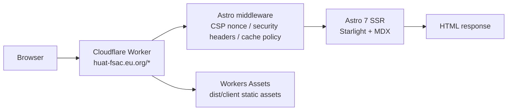

# HUAT FSAC · Guidance Astro

The official website and technical documentation platform for HUAT FSAC, the Formula Student team at Hubei University of Automotive Technology and the Dongfeng HUAT autonomous racing team. Built with Astro 7 + Starlight and served by Cloudflare Workers SSR.

[](https://github.com/HUAT-FSAC/Guidance-Astro/actions/workflows/ci-cd.yml)
[](./LICENSE)
[](./.nvmrc)
[](https://pnpm.io)
[](https://huat-fsac.eu.org)

[简体中文](./README.md) · English (this file)

## Overview

The site is both the team's public portal and a technical reference for members and visitors. Chinese is the default language, with English routes under `/en/`. It covers:

- **Team website**: team introductions, race cars, season reviews, sponsors, news, and recruitment.
- **Technical documentation**: the documentation center, season archives, open-source projects, and content contribution guidelines.
- **Interactive lab**: [Showcase Lab](https://huat-fsac.eu.org/showcase-dashboard/) demonstrates the perception → localization → planning → control → actuation loop in the browser, with scenario selection, subsystem panels, telemetry, and track replay.
- **Site infrastructure**: PWA support, light/dark modes and five color themes, CSP nonce hardening, SEO metadata, and a sitemap.

> Live site: <https://huat-fsac.eu.org>. Cloudflare Workers render pages on each request. The `*.pages.dev` domain does not contain SSR HTML; a 404 there is expected.

## Features

- **Cloudflare Workers SSR**: `output: 'server'` with `@astrojs/cloudflare`; HTML is generated by the Worker at request time.
- **Chinese and English**: default Chinese content lives in `src/content/docs/`, with English content in `src/content/docs/en/`, sharing Starlight navigation and i18n strings.
- **Site search**: a Pagefind full-text index generated at build time from real SSR-rendered pages, searchable in both languages via `Ctrl/Cmd+K`.
- **Interactive lab**: scenario presets, subsystem pipelines, telemetry, track replay, and a bilingual interface.
- **PWA**: `manifest.json`, a Service Worker, and an offline page support installation and offline access.
- **Themes**: light/dark modes and Classic Blue, Gaming Blue, Racing Red, Tech Purple, and Speed Green color themes.
- **Security hardening**: a fresh CSP nonce for each request, HSTS, COOP/CORP, Permissions-Policy, and private HTML caching.
- **Quality gates**: Vitest, Playwright E2E, Lighthouse CI, bundle and route budgets, theme contrast checks, and dependency auditing.
- **Optional analytics**: set `UMAMI_WEBSITE_ID` to enable Umami.

## Technology Stack

| Area                        | Technology                                                    |
| --------------------------- | ------------------------------------------------------------- |
| Framework                   | Astro 7.3 (`output: 'server'`)                                |
| Documentation theme         | Starlight 0.41                                                |
| Deployment adapter          | `@astrojs/cloudflare` 14 / Cloudflare Workers                 |
| Language                    | TypeScript 6                                                  |
| Content                     | MDX + Starlight content collections                           |
| Styling                     | Plain CSS and CSS custom properties; self-hosted fonts        |
| Testing                     | Vitest 4.1, Playwright 1.63                                   |
| Code quality                | ESLint 10, Prettier 3, Husky 9, commitlint 21, lint-staged 17 |
| Runtime and package manager | Node.js >= 22, pnpm 11.22                                     |
| Analytics                   | Umami (optional)                                              |

## Architecture



- `src/middleware.ts` composes cache policy, security headers, HTML transformation, and nonce injection. Each request receives a new nonce, also included in the CSP `script-src` directive.
- `pnpm build` produces `dist/client/` for static assets and `dist/server/` for the Worker entry point (`entry.mjs`) and deployment configuration (`wrangler.json`).
- Astro cannot automatically enumerate all dynamic content routes during an SSR build. `src/integrations/sitemap-paths.ts` scans the content directories to add those page paths to the sitemap.

## Quick Start

### Requirements

- Node.js >= 22 (the repository pins `22.23.2`; see [`.nvmrc`](./.nvmrc))
- pnpm `11.22.0` (see the `packageManager` field)
- Wrangler is installed as a development dependency (currently `4.147.0`) and is used for local SSR preview and deployment

### Local Development

```bash
git clone https://github.com/HUAT-FSAC/Guidance-Astro.git
cd Guidance-Astro
pnpm install
pnpm dev
```

The development server runs at <http://localhost:4321> by default.

### Environment Variables

Everyday development requires no environment variables. To enable Umami analytics, configure `.dev.vars`:

```bash
UMAMI_WEBSITE_ID=your-umami-website-id
```

`.dev.vars` is ignored by Git. See [`.dev.vars.example`](./.dev.vars.example) for the template.

### Common Commands

| Command                             | Description                                                                               |
| ----------------------------------- | ----------------------------------------------------------------------------------------- |
| `pnpm dev`                          | Start the development server                                                              |
| `pnpm build`                        | Create a production build                                                                 |
| `pnpm preview:ssr`                  | Run `pnpm build` first, then preview SSR locally with Wrangler at `http://127.0.0.1:8787` |
| `pnpm lint` / `pnpm lint:fix`       | Run ESLint / apply fixes                                                                  |
| `pnpm format` / `pnpm format:check` | Format with Prettier / check formatting                                                   |
| `pnpm exec tsc --noEmit`            | Check TypeScript types                                                                    |
| `pnpm test:run`                     | Run Vitest once                                                                           |
| `pnpm test:coverage`                | Generate coverage; statements, branches, functions, and lines each have an 80% threshold  |
| `pnpm build && pnpm test:e2e`       | Build, then run Playwright E2E tests                                                      |
| `pnpm quality:audit`                | Audit dependencies against an expiring allowlist                                          |
| `pnpm quality:bundle`               | Check build-size budgets                                                                  |
| `pnpm quality:routes`               | Check route-level budgets                                                                 |
| `pnpm quality:theme`                | Check theme contrast                                                                      |
| `pnpm quality:lighthouse`           | Run Lighthouse CI assertions                                                              |
| `pnpm deploy:worker`                | Build and deploy to Cloudflare Workers                                                    |
| `make ci`                           | Run local lint, formatting, type checks, unit tests, and build                            |

Use `make help` to list all Makefile shortcuts. Before the first E2E run, install Chromium: `pnpm exec playwright install chromium`.

## Writing Content

- Chinese content lives in `src/content/docs/`; English content lives in `src/content/docs/en/`. Pages need `title` and `description` frontmatter.
- Place documentation images in `src/assets/docs/<year>/<module>/`. Adjust relative paths for the page's location and import images through `astro:assets`:

```mdx
import { Image } from 'astro:assets'
import simulationNode from '../../assets/docs/2025/simulation/仿真-启动节点.webp'

<Image src={simulationNode} alt="Simulation node startup interface" />
```

- Escape `<` in MDX table cells (`\<1A`) or wrap it in inline code (`` `<1A` ``). Starlight Aside supports `note / tip / caution / danger`, not `warning`.
- `openwiki/` is generated by a scheduled workflow; do not edit it by hand.
- See [`docs/CONTRIBUTING-content.md`](./docs/CONTRIBUTING-content.md) for the full authoring guidelines.

## Testing and Quality Gates

| Layer               | Tool                   | Entry point                                             |
| ------------------- | ---------------------- | ------------------------------------------------------- |
| Unit/component      | Vitest 4.1             | `tests/unit/**`, `src/**/*.test.ts`                     |
| End-to-end          | Playwright 1.63        | `tests/e2e/**`, run against the SSR preview             |
| Performance         | Lighthouse CI          | `.config/lighthouserc.json`, performance threshold 0.80 |
| Build budgets       | Repository scripts     | `scripts/quality/*`                                     |
| Dependency security | pnpm audit + allowlist | `.config/audit-allowlist.json`                          |

On pushes and pull requests, [CI](./.github/workflows/ci-cd.yml) runs lint, type checks, tests and coverage, dependency auditing, builds, E2E, Lighthouse, and budget checks. Coverage thresholds are 80/80/80/80.

## Deployment

**CI does not deploy the site.** Pushing to `main` runs checks and builds, but does not update production. Maintainers deploy from their local machine using Wrangler OAuth.

```bash
# Once per machine
pnpm exec wrangler login

# Build and deploy
pnpm deploy:worker
```

After deployment, check the CSP header for a per-request `'nonce-…'` value in `script-src`:

```bash
curl -sI https://huat-fsac.eu.org/ | grep -i content-security-policy
```

- The Worker route `huat-fsac.eu.org/*` serves production. A 404 on `*.pages.dev` is expected.
- Do not delete the existing `huat-fsac.eu.org` DNS records in the Cloudflare zone.
- See [`docs/DEPLOYMENT.md`](./docs/DEPLOYMENT.md) for rollback, preview, and restoring automated CI deployment.

## Project Layout

```text
.
├── astro.config.mjs          # Astro / Starlight / sitemap / Vite configuration
├── wrangler.json             # Cloudflare account and compatibility date
├── .config/                  # Sidebar, Vitest, Playwright, LHCI configuration
├── public/                   # Manifest, sw.js, _headers, favicon, OG image
├── src/
│   ├── middleware.ts         # Security and cache middleware entry point
│   ├── middleware/           # Nonce, HTML transformation, headers, caching
│   ├── components/           # Home, docs, navigation, Starlight overrides
│   ├── content/docs/         # Chinese content (default locale)
│   ├── content/docs/en/      # English content
│   ├── data/                 # Cars, seasons, sponsors, Showcase Lab, metrics
│   ├── pages/                # Custom routes and /en routes
│   ├── config/               # CSP, monitoring, and other configuration
│   ├── integrations/         # Sitemap, CSS deduplication, warning filtering
│   └── utils/                # i18n, themes, navigation, and other utilities
├── scripts/                  # Quality, metrics, and asset scripts
├── tests/                    # Vitest unit tests + Playwright E2E
├── docs/                     # Repository docs: architecture, workflow, deployment, ADRs
└── openwiki/                 # Generated evidence index (do not edit by hand)
```

## Documentation

| Document                                                         | Contents                                                          |
| ---------------------------------------------------------------- | ----------------------------------------------------------------- |
| [`docs/README.md`](./docs/README.md)                             | Repository documentation index                                    |
| [`docs/ARCHITECTURE.md`](./docs/ARCHITECTURE.md)                 | System architecture, request flow, and directory responsibilities |
| [`docs/DEPLOYMENT.md`](./docs/DEPLOYMENT.md)                     | Deployment, rollback, verification, and restoring CI deployment   |
| [`docs/WORKFLOW.md`](./docs/WORKFLOW.md)                         | Development workflow and quality gates                            |
| [`docs/CONTRIBUTING-content.md`](./docs/CONTRIBUTING-content.md) | MDX, assets, and sidebar guidelines                               |
| [`docs/ROADMAP.md`](./docs/ROADMAP.md)                           | Roadmap                                                           |
| [`docs/adr/`](./docs/adr/)                                       | Architecture Decision Records                                     |
| [`CHANGELOG.md`](./CHANGELOG.md)                                 | Release history                                                   |

## Contributing

See [`.github/CONTRIBUTING.md`](./.github/CONTRIBUTING.md) for the full workflow. Before submitting, pass `make ci` and the relevant quality gates. Use [Conventional Commits](https://www.conventionalcommits.org/). Read the [Code of Conduct](./.github/CODE_OF_CONDUCT.md) before participating; see [Support](./.github/SUPPORT.md) for questions and assistance.

Use pnpm for dependencies: keep `pnpm-lock.yaml`, do not commit `package-lock.json`, and do not remove the build configuration in `pnpm-workspace.yaml`.

## Security

Do not report security vulnerabilities in public Issues. Use [GitHub Private Vulnerability Reporting](https://github.com/HUAT-FSAC/Guidance-Astro/security/advisories/new); see [`.github/SECURITY.md`](./.github/SECURITY.md) for details.

## License

[MIT](./LICENSE) © 2026 HUAT FSAC

## Related Links

- [Live site](https://huat-fsac.eu.org)
- [GitHub organization](https://github.com/HUAT-FSAC)
- [Astro documentation](https://docs.astro.build/)
- [Starlight documentation](https://starlight.astro.build/)
