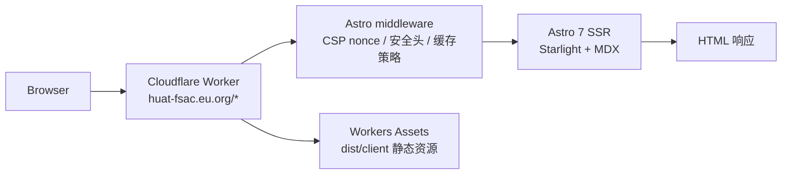

# HUAT FSAC · Guidance Astro

HUAT FSAC（湖北汽车工业学院方程式赛车队 / 东风 HUAT 无人驾驶车队）的官方网站与技术文档平台，基于 Astro 7 + Starlight 构建，运行在 Cloudflare Workers SSR 上。

[](https://github.com/HUAT-FSAC/Guidance-Astro/actions/workflows/ci-cd.yml)
[](./LICENSE)
[](./.nvmrc)
[](https://pnpm.io)
[](https://huat-fsac.eu.org)

简体中文（本文件） · [English](./README.en.md)

## 概览

本站是 HUAT FSAC 车队的线上门户，也是面向队员与访客的技术文档平台。默认中文，提供 `/en/` 英文路由，内容覆盖：

- **车队主页**：团队介绍、历代赛车、赛季回顾、赞助商、新闻与招新。
- **技术文档**：文档中心、赛季技术归档、开源项目与内容贡献规范。
- **交互实验室**：[Showcase Lab](https://huat-fsac.eu.org/showcase-dashboard/) 在浏览器中演示感知 → 定位 → 规划 → 控制 → 执行器的闭环，包含场景切换、子系统面板、遥测指标与赛道回放。
- **工程能力**：PWA、亮暗模式与 5 套主题色、CSP nonce 安全加固、SEO 元数据与 sitemap。

> 线上地址：<https://huat-fsac.eu.org>。页面由 Cloudflare Worker 按请求渲染；`*.pages.dev` 不包含 SSR HTML，访问返回 404 属预期行为。

## 特性

- **Cloudflare Workers SSR**：`output: 'server'` + `@astrojs/cloudflare`，HTML 由 Worker 运行时生成。
- **中英双语**：默认中文内容位于 `src/content/docs/`，英文内容位于 `src/content/docs/en/`，共用 Starlight 导航与 i18n 字符串。
- **站内搜索**：Pagefind 全文索引在构建期由真实 SSR 渲染页生成，支持中英文正文检索，`Ctrl/Cmd+K` 呼出。
- **交互式实验室**：场景预设、子系统流水线、遥测指标、赛道回放与中英双语界面。
- **PWA**：`manifest.json`、Service Worker 与离线页，支持安装和离线访问。
- **主题系统**：亮/暗模式，以及经典蓝、电竞蓝、赛道红、科技紫、极速绿 5 套主题色。
- **安全加固**：每请求 CSP nonce、HSTS、COOP/CORP、Permissions-Policy，以及 HTML 私有缓存策略。
- **质量门禁**：Vitest 单元测试、Playwright E2E、Lighthouse CI、包体积/路由预算、主题对比度与依赖审计。
- **可选分析**：配置 `UMAMI_WEBSITE_ID` 后启用 Umami。

## 技术栈

| 类别     | 选型                                                          |
| -------- | ------------------------------------------------------------- |
| 框架     | Astro 7.3（`output: 'server'`）                               |
| 文档主题 | Starlight 0.41                                                |
| 部署适配 | `@astrojs/cloudflare` 14 / Cloudflare Workers                 |
| 语言     | TypeScript 6                                                  |
| 内容     | MDX + Starlight content collections                           |
| 样式     | 原生 CSS + CSS 自定义属性；字体自托管                         |
| 测试     | Vitest 4.1、Playwright 1.63                                   |
| 代码质量 | ESLint 10、Prettier 3、Husky 9、commitlint 21、lint-staged 17 |
| 运行时   | Node.js >= 22、pnpm 11.22                                     |
| 分析     | Umami（可选）                                                 |

## 架构



- `src/middleware.ts` 依次执行缓存策略、安全响应头、HTML 转换与 nonce 注入；nonce 每次请求重新生成，并写入 CSP 的 `script-src`。
- `pnpm build` 生成 `dist/client/`（静态资源）与 `dist/server/`（Worker 入口 `entry.mjs` 和部署配置 `wrangler.json`）。
- 由于全站 SSR，Astro 构建期无法自动枚举动态内容路由；`src/integrations/sitemap-paths.ts` 会扫描内容目录，将页面路径补入 sitemap。

## 快速开始

### 环境要求

- Node.js >= 22（仓库固定为 `22.23.2`，见 [`.nvmrc`](./.nvmrc)）
- pnpm `11.22.0`（见 `packageManager`）
- Wrangler 已作为开发依赖安装（当前 `4.147.0`），本地 SSR 预览与部署时需要

### 本地开发

```bash
git clone https://github.com/HUAT-FSAC/Guidance-Astro.git
cd Guidance-Astro
pnpm install
pnpm dev
```

开发服务器默认运行在 <http://localhost:4321>。

### 环境变量

日常开发不需要环境变量。需要启用 Umami 分析时，在 `.dev.vars` 中配置：

```bash
UMAMI_WEBSITE_ID=your-umami-website-id
```

`.dev.vars` 已被 `.gitignore` 忽略，模板见 [`.dev.vars.example`](./.dev.vars.example)。

### 常用命令

| 命令                                | 说明                                                                   |
| ----------------------------------- | ---------------------------------------------------------------------- |
| `pnpm dev`                          | 启动开发服务器                                                         |
| `pnpm build`                        | 生产构建                                                               |
| `pnpm preview:ssr`                  | 先 `pnpm build`，再用 Wrangler 本地运行 SSR（`http://127.0.0.1:8787`） |
| `pnpm lint` / `pnpm lint:fix`       | ESLint 检查 / 自动修复                                                 |
| `pnpm format` / `pnpm format:check` | Prettier 格式化 / 校验                                                 |
| `pnpm exec tsc --noEmit`            | TypeScript 类型检查                                                    |
| `pnpm test:run`                     | Vitest 单次运行                                                        |
| `pnpm test:coverage`                | 覆盖率报告（语句/分支/函数/行均为 80%）                                |
| `pnpm build && pnpm test:e2e`       | 构建后运行 Playwright E2E                                              |
| `pnpm quality:audit`                | 依赖安全审计（带到期豁免清单）                                         |
| `pnpm quality:bundle`               | 构建体积预算                                                           |
| `pnpm quality:routes`               | 路由级预算                                                             |
| `pnpm quality:theme`                | 主题对比度检查                                                         |
| `pnpm quality:lighthouse`           | Lighthouse CI 断言                                                     |
| `pnpm deploy:worker`                | 构建并部署到 Cloudflare Workers                                        |
| `make ci`                           | 本地执行 lint、格式、类型、单测与构建                                  |

`make help` 可列出全部 Makefile 快捷命令。首次运行 E2E 前需安装浏览器：`pnpm exec playwright install chromium`。

## 内容编写

- 中文内容位于 `src/content/docs/`，英文内容位于 `src/content/docs/en/`；页面需提供 `title` 与 `description` frontmatter。
- 文档图片放在 `src/assets/docs/<year>/<module>/`，按页面层级调整相对路径，并通过 `astro:assets` 的 `<Image>` 引入：

```mdx
import { Image } from 'astro:assets'
import simulationNode from '../../assets/docs/2025/simulation/仿真-启动节点.webp'

<Image src={simulationNode} alt="仿真节点启动界面" />
```

- MDX 表格中的 `<` 需要转义（`\<1A`）或放入行内代码（`` `<1A` ``）；Starlight Aside 支持 `note / tip / caution / danger`，不支持 `warning`。
- `openwiki/` 由定时工作流生成，请勿手改。
- 完整规范见 [`docs/CONTRIBUTING-content.md`](./docs/CONTRIBUTING-content.md)。

## 测试与质量门禁

| 层级      | 工具                  | 入口                                                 |
| --------- | --------------------- | ---------------------------------------------------- |
| 单元/组件 | Vitest 4.1            | `tests/unit/**`、`src/**/*.test.ts`                  |
| 端到端    | Playwright 1.63       | `tests/e2e/**`，针对 SSR 预览运行                    |
| 性能      | Lighthouse CI         | `.config/lighthouserc.json`，performance 阈值为 0.80 |
| 构建预算  | 自研脚本              | `scripts/quality/*`                                  |
| 依赖安全  | pnpm audit + 豁免清单 | `.config/audit-allowlist.json`                       |

CI（[`.github/workflows/ci-cd.yml`](./.github/workflows/ci-cd.yml)）在 push 和 PR 时执行 lint、类型检查、测试与覆盖率、依赖审计、构建、E2E、Lighthouse 与预算检查；覆盖率为 80/80/80/80。

## 部署

当前 **CI 不负责部署**：`push main` 只运行检查与构建，不会上线。线上由维护者在本机通过 Wrangler OAuth 执行部署。

```bash
# 每台机器首次
pnpm exec wrangler login

# 构建并部署
pnpm deploy:worker
```

部署后检查 CSP 头，确认其中包含每请求生成的 `'nonce-…'`（位于 `script-src`）：

```bash
curl -sI https://huat-fsac.eu.org/ | grep -i content-security-policy
```

- 线上由 Worker 路由 `huat-fsac.eu.org/*` 提供服务；`*.pages.dev` 返回 404 是预期行为。
- 不要删除 Cloudflare zone 中 `huat-fsac.eu.org` 的 DNS 记录。
- 回滚、Preview 与恢复 CI 自动部署的方式见 [`docs/DEPLOYMENT.md`](./docs/DEPLOYMENT.md)。

## 项目结构

```text
.
├── astro.config.mjs          # Astro / Starlight / sitemap / Vite 配置
├── wrangler.json             # Cloudflare 账号与 compatibility date
├── .config/                  # sidebar、Vitest、Playwright、LHCI 等集中配置
├── public/                   # manifest、sw.js、_headers、favicon、OG 图
├── src/
│   ├── middleware.ts         # 安全与缓存中间件入口
│   ├── middleware/           # nonce、HTML 转换、安全头、缓存策略
│   ├── components/           # 首页、文档、导航、Starlight 覆盖组件
│   ├── content/docs/         # 中文内容（默认 locale）
│   ├── content/docs/en/      # 英文内容
│   ├── data/                 # 赛车、赛季、赞助商、Showcase Lab、指标数据
│   ├── pages/                # 自定义路由与 /en 路由
│   ├── config/               # CSP、监控等配置
│   ├── integrations/         # sitemap、CSS 去重、构建警告过滤
│   └── utils/                # i18n、主题、导航等工具
├── scripts/                  # 质量、指标、资源处理脚本
├── tests/                    # Vitest 单元 + Playwright E2E
├── docs/                     # 仓库文档（架构、流程、部署、ADR）
└── openwiki/                 # 自动生成的证据索引（勿手改）
```

## 文档

| 文档                                                             | 内容                           |
| ---------------------------------------------------------------- | ------------------------------ |
| [`docs/README.md`](./docs/README.md)                             | 仓库文档索引                   |
| [`docs/ARCHITECTURE.md`](./docs/ARCHITECTURE.md)                 | 系统架构、请求链路、目录职责   |
| [`docs/DEPLOYMENT.md`](./docs/DEPLOYMENT.md)                     | 部署、回滚、验收与恢复 CI 部署 |
| [`docs/WORKFLOW.md`](./docs/WORKFLOW.md)                         | 开发流程与质量门禁             |
| [`docs/CONTRIBUTING-content.md`](./docs/CONTRIBUTING-content.md) | MDX、资产与侧边栏规范          |
| [`docs/ROADMAP.md`](./docs/ROADMAP.md)                           | 路线图                         |
| [`docs/adr/`](./docs/adr/)                                       | 架构决策记录                   |
| [`CHANGELOG.md`](./CHANGELOG.md)                                 | 版本记录                       |

## 贡献

完整流程见 [`.github/CONTRIBUTING.md`](./.github/CONTRIBUTING.md)。提交前请确保通过 `make ci` 及相关质量门禁，提交信息遵循 [Conventional Commits](https://www.conventionalcommits.org/)。参与前请阅读 [`.github/CODE_OF_CONDUCT.md`](./.github/CODE_OF_CONDUCT.md)，提问与支持见 [`.github/SUPPORT.md`](./.github/SUPPORT.md)。

依赖使用 pnpm 管理：保留 `pnpm-lock.yaml`，不要提交 `package-lock.json`；不要删除 `pnpm-workspace.yaml` 中的构建配置。

## 安全

请勿在公开 Issue 中提交安全漏洞。请使用 [GitHub Private Vulnerability Reporting](https://github.com/HUAT-FSAC/Guidance-Astro/security/advisories/new)，详情见 [`.github/SECURITY.md`](./.github/SECURITY.md)。

## 许可证

[MIT](./LICENSE) © 2026 HUAT FSAC

## 相关链接

- [线上站点](https://huat-fsac.eu.org)
- [GitHub 组织](https://github.com/HUAT-FSAC)
- [Astro 文档](https://docs.astro.build/)
- [Starlight 文档](https://starlight.astro.build/)
